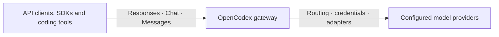

# OpenCodex

**Your models. Your clients. One gateway.**

OpenCodex (`ocx`) is a local-first model gateway with OpenAI-compatible and Anthropic-compatible APIs, provider routing, account management, a web dashboard and optional coding-client integrations. **You do not need to install or run Codex to use the gateway.**

[](https://www.npmjs.com/package/@groeponline/opencodex)
[](./LICENSE)
[Documentation](https://opencodex.chefgroep.online/) · [CLI reference](./docs-site/src/content/docs/reference/cli.md) · [Configuration](./docs-site/src/content/docs/reference/configuration.md) · [Issues](https://github.com/GroepOnline/opencodex/issues)

> **Know what you are running:** the `main` branch, the most recently published npm package and a deployed service can be at different versions. Built-in model presets do not grant upstream model access. Check `ocx --version`, your provider credentials and the [releases](https://github.com/GroepOnline/opencodex/releases) separately.

## What it does



OpenCodex has three independently usable parts:

- **Gateway:** a local HTTP API with provider adapters, a model catalog, routing, optional account pooling, usage and request diagnostics.
- **Client integration:** explicit launchers and synchronization for compatible tools, including Codex, Claude Code, Claude Desktop, OpenCode, Factory Droid and Grok Build.
- **Provider access:** your existing API keys, supported OAuth logins or locally served models. Upstream availability, costs, permissions and terms still apply.

The gateway does not require a Codex installation, a Codex session or a paid native-client subscription. Individual third-party clients can have their own login requirements; API calls can still incur provider charges.

## Get started

Install using **Node.js 18+**. The npm package depends on Bun and provides the `ocx` launcher; a separate Bun installation is required for source development, not for normal npm installation.

```bash
npm install -g @groeponline/opencodex
ocx start --proxy-only
```

`--proxy-only` starts the gateway without changing client configuration, Codex history or launchers. The default address is `http://127.0.0.1:10100`. In another terminal:

```bash
ocx status
curl -fsS http://127.0.0.1:10100/healthz
curl -fsS http://127.0.0.1:10100/v1/models
ocx gui
```

A fresh installation can return an empty model catalog until you add a provider. If the port is occupied, OpenCodex can use another available local port; consult `ocx status` or `ocx gui` for the live address.

Configure your first provider using the dashboard or guided setup:

```bash
ocx init
ocx provider list
ocx models list
ocx provider --help
```

Provider presets and custom OpenAI-compatible endpoints are supported. Use a supported API key or OAuth login, and prefer environment references over storing plaintext credentials. Configuration defaults to `~/.opencodex/config.json` (customizable with `OPENCODEX_HOME`). See the [provider guide](./docs-site/src/content/docs/guides/providers.md) and [configuration reference](./docs-site/src/content/docs/reference/configuration.md).

## Use OpenCodex from your preferred client

All integrations below are **optional**; the corresponding third-party executable or application must already be installed.

| Surface | Command / endpoint | Integration behavior |
| --- | --- | --- |
| HTTP clients and SDKs | `http://127.0.0.1:10100/v1` | Use the compatible gateway API directly |
| Codex CLI and App | `ocx init` / `ocx sync --codex-only` | Opt-in config and model catalog synchronization |
| Claude Code | `ocx claude` | Launch with scoped Anthropic gateway variables and model discovery |
| Claude Desktop | `ocx claude desktop` | Save and apply an OCX model-library profile |
| OpenCode | `ocx opencode` | Launch with a temporary runtime provider config, without rewriting project files |
| Factory Droid | `ocx droid` | Launch with a temporary OCX custom-model settings overlay |
| Grok Build | `ocx grok` | Inspect and manage the supported model-fence integration |
| Compatible Copilot/other apps | `/v1/models` and `/v1/chat/completions` | Configure a custom OpenAI-compatible provider where the app supports one |

### Claude Code

```bash
ocx claude
```

The launcher starts an installed Claude Code executable with the gateway environment and model slots; user-exported `ANTHROPIC_*` settings take precedence. Native picker/discovery support depends on the installed Claude Code version. See the [Claude Code guide](./docs-site/src/content/docs/guides/claude-code.md).

### Claude Desktop

```bash
ocx claude desktop show
ocx claude desktop               # save and apply the configured profile
ocx claude desktop sync
ocx claude desktop doctor --json    # diagnostic only; does not apply a profile
ocx sync --desktop-only          # do not touch Codex
```

The OCX profile organizes routes into Opus, Fable, Sonnet and Haiku families, with JSON import/export and explicit application. A running Desktop conversation may keep an in-memory model selection until reloaded. Since the main-only hardening in #349, apply/sync use a shared cross-process library lock and keep at most three protected pre-sync backups; `ocx claude desktop doctor --json` reports local diagnostics, not proof that Desktop reloaded or that a vendor inference succeeded. This integration does not guarantee parity with every native Claude feature. See the [Desktop integration guide](./docs-site/src/content/docs/guides/claude-desktop-sync.md).

### OpenCode and Factory Droid

```bash
ocx opencode                    # requires the opencode CLI
ocx droid                       # requires the Factory droid CLI
```

The OpenCode launcher injects a `provider.opencodex` block through the runtime config layer. It does not overwrite on-disk global or project configuration. Droid receives a temporary `--settings` overlay; the launcher does not rewrite `~/.factory/settings.json`.

**Droid integration boundary:** the main-only #355 regressions cover stable model identities, a 117-model existing-settings fixture, explicit data-plane admission without management-token leakage, and differentiated HTTP discovery errors. These simulate the vendor merge contract; they do **not** prove an installed Factory CLI actually merges the overlay, preserves a live selection, or completes authenticated inference. Do not assume an existing Factory custom-model selection is preserved in a live launch until verified with the Factory version you use. The temporary file is removed after the launched process exits.

Read the [OpenCode guide](./docs-site/src/content/docs/guides/opencode.md), [Grok Build guide](./docs-site/src/content/docs/guides/grok-build.md) and [Codex integration guide](./docs-site/src/content/docs/guides/codex-integration.md) for client-specific setup.

## Protocols and model routing

The gateway exposes the following routes:

| Route | Method | Purpose |
| --- | --- | --- |
| `/healthz` | `GET` | Health check |
| `/v1/models` | `GET` | Visible model catalog |
| `/v1/responses` | `POST` | OpenAI Responses-compatible API |
| `/v1/chat/completions` | `POST` | Chat Completions-compatible API |
| `/v1/messages` | `POST` | Anthropic Messages-compatible API |
| `/v1/images/generations` and `/v1/images/edits` | `POST` | Image API, where configured and supported |
| `/api/*` | Various | Management and dashboard endpoints |

For unambiguous routing, select a configured model as `provider/model` (for example, `ollama/<model-id>`). Bare model IDs may be resolved by configured defaults, provider prefixes or model lists. Aliases, combo routes and visibility settings can affect the catalog. A catalog entry is **not** proof that a particular account supports streaming, tools, images, reasoning or inference for that model.

Supported adapter families include OpenAI-compatible Chat Completions, OpenAI Responses, Anthropic Messages, Google Gemini and Azure OpenAI, plus provider-specific bridges. The registry has presets for hosted providers and local OpenAI-compatible servers (for example Ollama or vLLM). Do not infer a guaranteed model list, window size or provider count from a screenshot or from default metadata. See [adapters](./docs-site/src/content/docs/reference/adapters.md) and [routing](./docs-site/src/content/docs/guides/model-routing.md).

### OpenAI account routing

The `openai` Codex-login route supports a pool of eligible accounts or a direct credential mode. `openai-apikey` is a **separate** API-key route. These credential sources are intentionally isolated; one is not an automatic fallback for the other. Existing Codex sessions can retain account affinity, while account selection for new sessions follows the configured pool rules.

```bash
ocx account list
ocx account current openai
ocx provider list
```

Use the dashboard for account selection and quota refresh. Neither a seeded model entry nor a login alone proves an upstream request will succeed.

## Operations

```bash
ocx health --json                # runtime health, machine-readable
ocx doctor                       # environment and connectivity diagnostics
ocx observe logs                 # inspect request logs
ocx observe usage                # inspect usage
ocx trace list                   # inspect stored trace metadata, if enabled
ocx trace show <trace-id>        # metadata only unless --body is provided
ocx models list                  # inspect configured model catalog
ocx sync                         # synchronize configured clients independently
ocx service status               # installed service details
```

The dashboard provides provider/account controls, models, traffic and usage views. Stored trace bodies can be sensitive; `--body` explicitly reveals them while the default trace command does not. Enable capture and retention deliberately.

### Background service and restore

```bash
ocx service install              # optional OS-managed background service
ocx codex-shim install           # optional Codex on-demand gateway startup
ocx stop                         # stop the running gateway
ocx restore                      # restore managed native Codex configuration
ocx uninstall                    # remove safely-owned OCX service/integration state
npm uninstall -g @groeponline/opencodex
```

Platform support covers macOS, Linux and Windows; actual service management uses the appropriate host mechanism. `ocx uninstall` deliberately retains ambiguous legacy/shared data if ownership cannot be established rather than deleting it unconditionally. Use `ocx help uninstall` for current behavior.

### Remote access and security

The default listener is loopback-only. Do **not** expose the management API or model proxy publicly without authentication. Binding to a non-loopback interface requires an admission token (for example via `OPENCODEX_API_AUTH_TOKEN`) and authenticated client requests. For remote access, provide TLS and a deliberate access/identity boundary; a port forward alone is not a security policy.

See [management API](./docs-site/src/content/docs/reference/management-api.md), [Access vs. Authentik](./docs-site/src/content/docs/guides/access-vs-authentik.md) and [security policy](./SECURITY.md).

## Development and releases

Source development requires the `bun` CLI on your `PATH`. This is separate from the published npm package's bundled Bun runtime, which is used only by installed `ocx` commands.

```bash
git clone https://github.com/GroepOnline/opencodex.git
cd opencodex
bun install
bun run start                    # proxy; use a second terminal for the GUI dev server
bun run dev:gui
bun run typecheck
bun run test
bun run privacy:scan
```

The installed npm package contains a built dashboard; in a source checkout, build it with `bun run build:gui` if `gui/dist` does not yet exist. Source changes on `main`, npm publication, immutable container publication and private deployment are **different milestones**. Do not interpret a merged PR as proof of a live deployment. See [release process](./RELEASE_PROCESS.md), [contributing](./CONTRIBUTING.md) and [roadmap](./ROADMAP.md).

Documentation source is maintained in [`docs-site/`](./docs-site) (configured for [opencodex.chefgroep.online](https://opencodex.chefgroep.online/)). Maintainer and historical material lives in [`docs/`](./docs) and [`structure/`](./structure). Prefer the current CLI help/source when older guides disagree with the implementation.

## Compatibility and license

OpenCodex is independent and not affiliated with or endorsed by OpenAI, Anthropic, Factory or any upstream provider. Read each provider's terms before routing account-based traffic through a third-party gateway; unofficial access can be restricted. Model availability and client feature parity depend on provider, adapter, account and client version.

Report security issues privately using [GitHub security advisories](https://github.com/GroepOnline/opencodex/security/advisories/new), not a public issue. Licensed under [MIT](./LICENSE).
