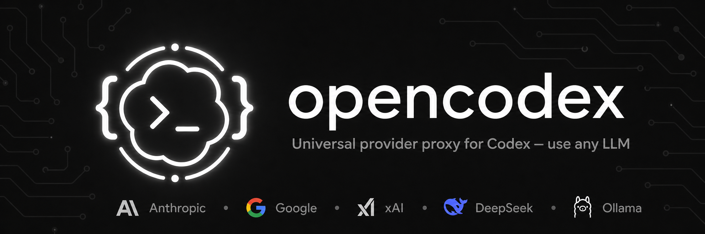
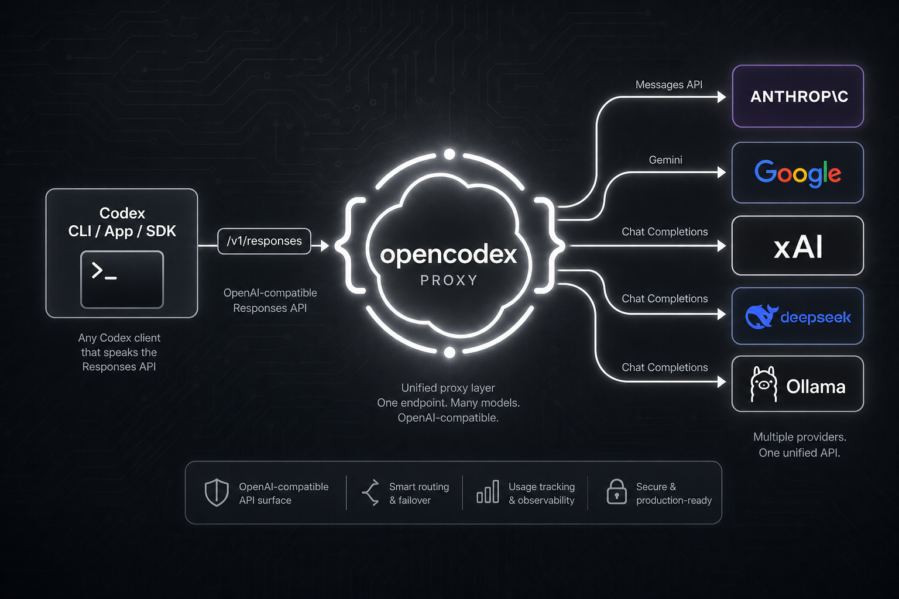
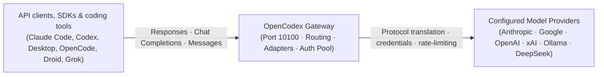
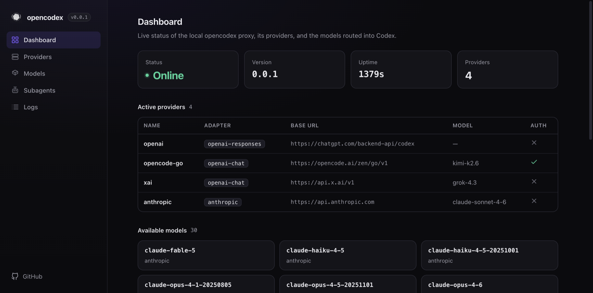
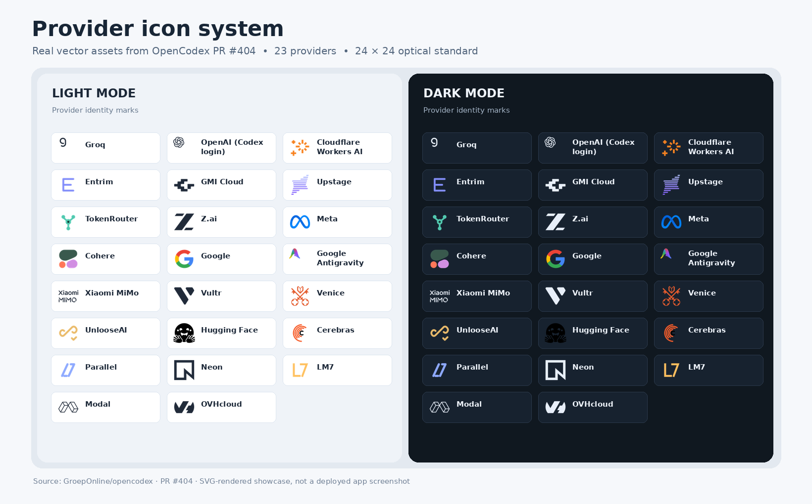
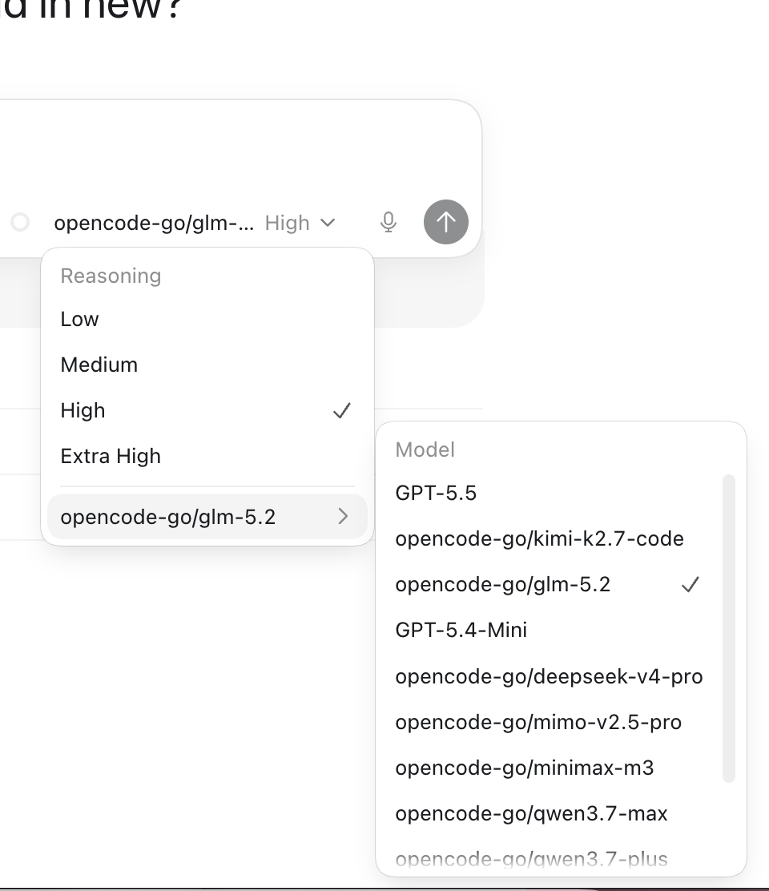
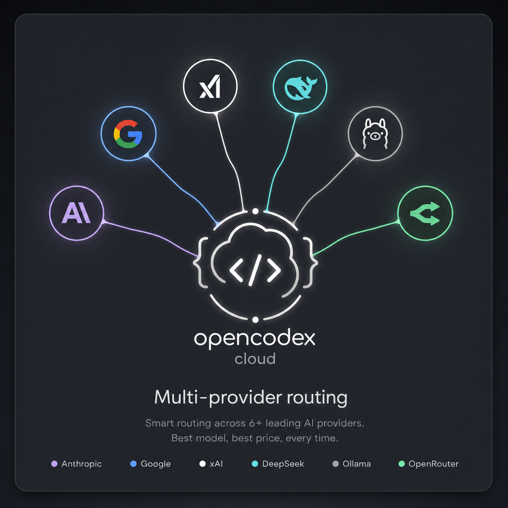
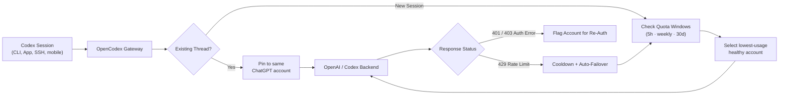

<p align="center">
  
</p>

# OpenCodex

**Your models. Your clients. One gateway.**

OpenCodex (`ocx`) is a universal, local-first model gateway with OpenAI-compatible and Anthropic-compatible APIs, 40+ provider adapters, account pooling, a live web dashboard, and optional coding-client integrations (Codex, Claude Code, Claude Desktop, OpenCode, Factory Droid, Grok Build). **You do not need to install or run Codex to use the gateway.**

[](https://www.npmjs.com/package/@groeponline/opencodex)
[](https://nodejs.org)
[](./LICENSE)
[](https://opencodex.chefgroep.online/)

[Documentation](https://opencodex.chefgroep.online/) · [CLI reference](./docs-site/src/content/docs/reference/cli.md) · [Configuration](./docs-site/src/content/docs/reference/configuration.md) · [Releases](https://github.com/GroepOnline/opencodex/releases) · [Issues](https://github.com/GroepOnline/opencodex/issues)

> **Know what you are running:** the `main` branch, the most recently published npm package and a deployed service can be at different versions. Built-in model presets do not grant upstream model access. Check `ocx --version`, your provider credentials and the [releases](https://github.com/GroepOnline/opencodex/releases) separately.

---

## Interactive Client Demos

OpenCodex connects your favorite coding environments to any LLM provider without losing native UI capabilities or client features:

<table align="center">
  <tr>
    <td width="50%" align="center">
      <br>
      <sub><b>Claude Code, running any model.</b><br>The picker is stock Claude Code. The brain behind it isn't.</sub>
    </td>
    <td width="50%" align="center">
      <br>
      <sub><b>Codex, running any model.</b><br>Pick a provider and go — same workflow, different brain.</sub>
    </td>
  </tr>
  <tr>
    <td width="50%" align="center">
      <br>
      <sub><b>Claude Desktop, running any model.</b><br>Opus answers, then hands the task to a GPT-5.6 Sol subagent.</sub>
    </td>
    <td width="50%" align="center">
      <br>
      <sub><b>Grok Build, running any model.</b><br>Sol drives the session and calls a Kimi K3 subagent.</sub>
    </td>
  </tr>
</table>

---

## What OpenCodex Does

<p align="center">
  
</p>

OpenCodex has three independently usable components:

- **Gateway:** A local HTTP API exposing OpenAI Responses, OpenAI Chat Completions, and Anthropic Messages endpoints, with provider adapters, model catalog generation, routing, optional account pooling, and live request diagnostics.
- **Client integration:** Explicit launchers, runtime environment bridges, and synchronization for compatible tools, including Codex, Claude Code, Claude Desktop, OpenCode, Factory Droid, and Grok Build.
- **Provider access:** Use your existing API keys, supported OAuth logins, or locally served models (Ollama, vLLM, LM Studio). Upstream availability, costs, permissions, and terms still apply.

The gateway does not require a Codex installation, a Codex session, or a paid native-client subscription. Individual third-party clients can have their own login requirements; API calls can still incur provider charges.



---

## Web Dashboard

Manage your providers, test connections, view live request logs, track token usage, and monitor account quotas in real time via the built-in web dashboard:

<p align="center">
  
</p>

Launch the dashboard at any time with:

```bash
ocx gui
```

---

## 40+ Supported Providers

OpenCodex comes preloaded with normalized adapters and theme-aware SVG artwork for all major commercial, open-source, and self-hosted model providers:

<p align="center">
  
</p>

Supported adapter families include:

- **OpenAI Responses:** Full streaming, tool calls, reasoning summaries, and image generation.
- **OpenAI Chat Completions:** Standard `/v1/chat/completions` compatibility for hundreds of providers.
- **Anthropic Messages:** Native `/v1/messages` protocol with `count_tokens` support.
- **Google Gemini:** Direct Gemini API adapter with reasoning and search grounding support.
- **Azure OpenAI & Custom Gateways:** Cloudflare AI Gateway, Vercel AI Gateway, OpenRouter, and more.
- **Local Runtimes:** Ollama, LM Studio, vLLM, and any custom OpenAI-compatible server.

---

## Get Started

### Prerequisites

- **Node.js 18+** (installed via nvm, fnm, or system package manager).
- The npm package bundles its own Bun runtime; a separate Bun installation is **not** required for running `ocx`.

### 1. Installation

```bash
npm install -g @groeponline/opencodex
```

### 2. Start the Gateway (Proxy-Only Mode)

`--proxy-only` starts the gateway API and web dashboard without modifying client configuration, Codex history, or shell launchers:

```bash
ocx start --proxy-only
```

The gateway listens at `http://127.0.0.1:10100` by default. If the port is busy, OpenCodex automatically selects an available port.

### 3. Verify and Configure

In another terminal:

```bash
# Check status and live port
ocx status

# Health check
curl -fsS http://127.0.0.1:10100/healthz

# Inspect visible model catalog
curl -fsS http://127.0.0.1:10100/v1/models

# Open the dashboard
ocx gui
```

Run guided interactive onboarding or manage providers via CLI:

```bash
ocx init
ocx provider list
ocx models list
ocx provider --help
```

See the [provider guide](./docs-site/src/content/docs/guides/providers.md) and [configuration reference](./docs-site/src/content/docs/reference/configuration.md).

---

## Use OpenCodex From Your Preferred Client

All integrations below are **optional**; the corresponding third-party tool must already be installed.

| Surface                   | Command / Endpoint                    | Integration Behavior                                                      |
| :------------------------ | :------------------------------------ | :------------------------------------------------------------------------ |
| **HTTP clients & SDKs**   | `http://127.0.0.1:10100/v1`           | Use standard OpenAI or Anthropic SDKs pointing to the gateway             |
| **Codex CLI and App**     | `ocx init` / `ocx sync --codex-only`  | Opt-in config and model catalog synchronization                           |
| **Claude Code**           | `ocx claude`                          | Launch with scoped Anthropic gateway variables and model discovery        |
| **Claude Desktop**        | `ocx claude desktop`                  | Save and apply an OCX model-library profile (Opus, Fable, Sonnet, Haiku)  |
| **OpenCode**              | `ocx opencode`                        | Launch with a temporary runtime provider config without overwriting files |
| **Factory Droid**         | `ocx droid`                           | Launch with a temporary OCX custom-model settings overlay                 |
| **Grok Build**            | `ocx grok`                            | Inspect and manage the supported model-fence integration                  |
| **Copilot / Custom Apps** | `/v1/models` & `/v1/chat/completions` | Configure custom OpenAI-compatible provider endpoints                     |

### Claude Code

```bash
ocx claude
```

The launcher starts an installed Claude Code executable with the gateway environment and model slots; user-exported `ANTHROPIC_*` settings take precedence. Native picker discovery support depends on the installed Claude Code version. See the [Claude Code guide](./docs-site/src/content/docs/guides/claude-code.md).

### Claude Desktop

```bash
ocx claude desktop show
ocx claude desktop               # save and apply the configured profile
ocx claude desktop sync          # synchronize configured profiles through the local gateway
ocx claude desktop doctor --json # diagnostic check; does not apply a profile
ocx sync --desktop-only          # desktop only; does not touch Codex
```

The OCX profile organizes routes into **Opus**, **Fable**, **Sonnet**, and **Haiku** families, with JSON import/export and explicit profile application. Apply/sync commands use a shared cross-process library lock and keep at most three protected pre-sync backups. See the [Desktop integration guide](./docs-site/src/content/docs/guides/claude-desktop-sync.md).

### OpenCode and Factory Droid

```bash
ocx opencode                    # requires the opencode CLI
ocx droid                       # requires the Factory droid CLI
```

- **OpenCode:** The launcher injects a `provider.opencodex` block through the runtime configuration layer without overwriting on-disk global or project files.
- **Factory Droid:** Droid receives a temporary `--settings` overlay; the launcher does not rewrite `~/.factory/settings.json`. The temporary file is automatically cleaned up when the process exits.

Read the [OpenCode guide](./docs-site/src/content/docs/guides/opencode.md), [Grok Build guide](./docs-site/src/content/docs/guides/grok-build.md), and [Codex integration guide](./docs-site/src/content/docs/guides/codex-integration.md) for client-specific setup.

### Codex App Model Picker & Reasoning Controls

When integrated with Codex, routed models appear directly in the Codex App model picker with full per-model reasoning effort controls (`low`, `medium`, `high`, `xhigh`, `max`, `ultra`):

<p align="center">
  
</p>

---

## Protocols and Model Routing

<p align="center">
  
</p>

### Gateway Endpoints

| Route                    | Method  | Purpose                                    |
| :----------------------- | :------ | :----------------------------------------- |
| `/healthz`               | `GET`   | Health check and readiness probe           |
| `/v1/models`             | `GET`   | Visible model catalog and metadata         |
| `/v1/responses`          | `POST`  | OpenAI Responses-compatible API            |
| `/v1/chat/completions`   | `POST`  | Chat Completions-compatible API            |
| `/v1/messages`           | `POST`  | Anthropic Messages-compatible API          |
| `/v1/images/generations` | `POST`  | Native image generation endpoint           |
| `/v1/images/edits`       | `POST`  | Native image editing endpoint              |
| `/api/*`                 | Various | Management, quota, and dashboard endpoints |

### Model Selector Syntax

Target any configured provider and model using `provider/model`:

```bash
# Claude Sonnet via Anthropic
codex -m "anthropic/claude-3-7-sonnet" "Refactor this function"

# Gemini Pro via Google
codex -m "google/gemini-2.5-pro" "Analyze this performance bottleneck"

# Local model via Ollama
codex -m "ollama/llama3.3" "Write unit tests for auth.ts"

# DeepSeek via DeepSeek API
codex -m "deepseek/deepseek-reasoner" "Optimize this SQL query"
```

When omitting the `provider/` prefix, OpenCodex resolves the model via the default provider or pattern-based matching (e.g., `claude-*` routes to Anthropic, `gpt-*` routes to OpenAI). See [adapters reference](./docs-site/src/content/docs/reference/adapters.md) and [routing guide](./docs-site/src/content/docs/guides/model-routing.md).

---

## OpenAI Account Routing & Quota Pooling

OpenCodex includes an intelligent multi-account pool for Codex login sessions:

| Provider ID     | Route       | Credential                          | Behavior                                             |
| :-------------- | :---------- | :---------------------------------- | :--------------------------------------------------- |
| `openai`        | Codex login | Main + added ChatGPT/Codex accounts | Pool by default; optional Direct mode                |
| `openai-apikey` | OpenAI API  | API key / key pool                  | Standard API-key route without Codex session routing |



- **Thread Affinity:** In-flight sessions and ongoing threads remain pinned to the same account to prevent disruptions during multi-turn coding sessions.
- **Smart Failover:** 429 rate-limit responses place an account in cooldown and seamlessly fail over new requests to another healthy account.
- **Non-PII Request Logging:** The dashboard and request logs display non-PII account ordinals.

```bash
ocx account list
ocx account current openai
ocx provider list
```

---

## Configuration

Configuration defaults to `~/.opencodex/config.json` (customizable via `OPENCODEX_HOME`):

```json
{
  "port": 10100,
  "defaultProvider": "anthropic",
  "providers": {
    "anthropic": {
      "adapter": "anthropic",
      "baseUrl": "https://api.anthropic.com",
      "authMode": "oauth",
      "defaultModel": "claude-3-7-sonnet"
    },
    "google": {
      "adapter": "google",
      "apiKey": "${GEMINI_API_KEY}",
      "defaultModel": "gemini-2.5-pro"
    },
    "ollama": {
      "adapter": "openai-chat",
      "baseUrl": "http://localhost:11434/v1",
      "authMode": "key",
      "apiKey": "",
      "defaultModel": "llama3.3"
    }
  }
}
```

Consult the [configuration reference](./docs-site/src/content/docs/reference/configuration.md) for context window capping, token limits, and WebSocket settings.

---

## Operations & CLI Reference

```bash
ocx health --json                # runtime health, machine-readable
ocx doctor                       # environment and connectivity diagnostics
ocx observe logs                 # inspect live request logs
ocx observe usage                # inspect token and cost usage
ocx trace list                   # inspect stored trace metadata
ocx trace show <trace-id>        # metadata only; add --body to reveal payload
ocx models list                  # inspect configured model catalog
ocx sync                         # synchronize configured clients independently
ocx service status               # check background service status
```

### Background Service and Auto-Start

| Operating System | Background Service Manager                    | On-Demand Shim           |
| :--------------- | :-------------------------------------------- | :----------------------- |
| **macOS**        | `launchd` user agent                          | `ocx codex-shim install` |
| **Linux**        | `systemd` user unit                           | `ocx codex-shim install` |
| **Windows**      | Task Scheduler (hidden) or WinSW (`--native`) | `ocx codex-shim install` |

```bash
ocx service install              # install OS-managed background service
ocx codex-shim install           # install on-demand Codex launcher shim
ocx stop                         # stop running gateway and background service
ocx restore                      # restore managed native Codex configuration
ocx uninstall                    # cleanly remove OCX services and integration state
```

### Remote Access and Security

The default listener is strictly bound to `127.0.0.1` (loopback). Do **not** expose the management API or model proxy publicly without authentication. Binding to a non-loopback interface (`0.0.0.0` or LAN) requires an admission token:

```bash
export OPENCODEX_API_AUTH_TOKEN="your-strong-secret-token"
ocx start
```

For remote access, use TLS termination, SSH tunnels, or a dedicated identity reverse proxy. See [management API reference](./docs-site/src/content/docs/reference/management-api.md), [Access vs. Authentik guide](./docs-site/src/content/docs/guides/access-vs-authentik.md), and [security policy](./SECURITY.md).

---

## Development and Contributing

Source development requires the `bun` CLI on your `PATH`. This is separate from the published npm package's bundled Bun runtime, which is used only by installed `ocx` commands.

```bash
# Clone repository
git clone https://github.com/GroepOnline/opencodex.git
cd opencodex

# Install dependencies
bun install

# Start development proxy and web dashboard
bun run start
bun run dev:gui

# Run code quality and test suites
bun run typecheck
bun run test
bun run privacy:scan
```

The installed npm package contains a pre-built dashboard; in a source checkout, run `bun run build:gui` if `gui/dist` does not yet exist.

For more details on contributing, release workflows, and the roadmap:

- [Contributing Guide](./CONTRIBUTING.md)
- [Release Process](./RELEASE_PROCESS.md)
- [Roadmap](./ROADMAP.md)
- [Documentation Source (`docs-site/`)](./docs-site)
- [Internal Docs (`docs/`)](./docs)
- [Architecture Structure (`structure/`)](./structure)

---

## Compatibility and License

OpenCodex is independent and not affiliated with or endorsed by OpenAI, Anthropic, Factory, or any upstream provider. Read each provider's terms of service before routing traffic through a third-party gateway; unofficial access can be restricted. Model availability and client feature parity depend on provider, adapter, account, and client version.

Report security issues privately using [GitHub security advisories](https://github.com/GroepOnline/opencodex/security/advisories/new) rather than public issues.

Licensed under the [MIT License](./LICENSE).
